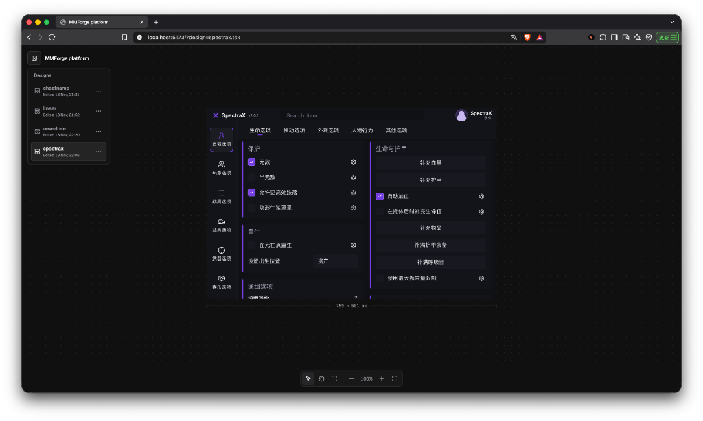
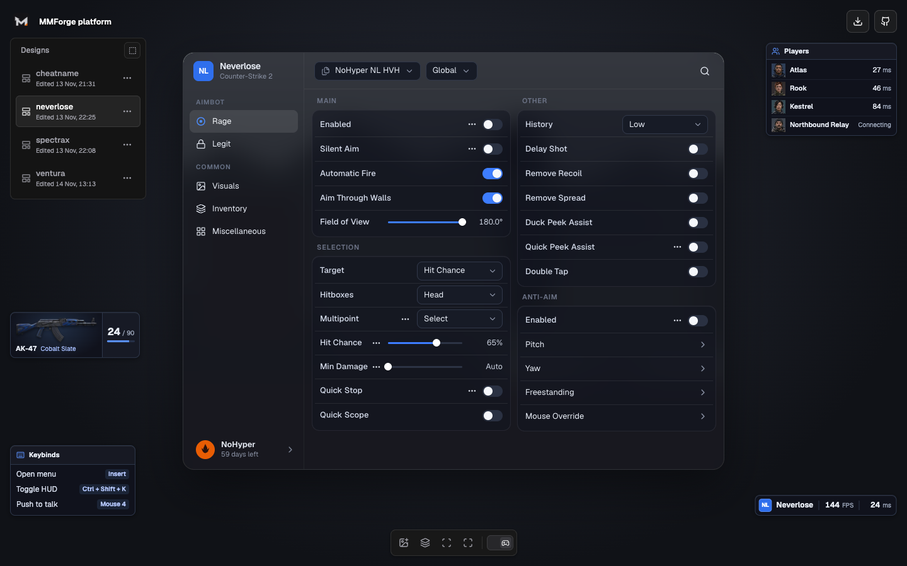

# mmforge-platform

Design cheat menus and HUD widgets with AI.

 [](https://github.com/EunChae1110/mmforge-platform/releases/latest)

Use MMForge with Cursor, Claude Code, Codex, and general ai agent. Build a cheat menu from a prompt, recreate one from a screenshot, or select a control in the local Canvas and ask AI to change it. Controls and HUD readings use demo data.



## Install

```bash
npx skills add EunChae1110/mmforge-platform --skill mmforge-platform
```

Add `-g` to install it for every project on this machine. Add `-y` to skip the prompts.

Run these commands from the MMForge project root. For a standalone setup, copy the installed skill's `assets/canvas/` contents into your workspace first.

```bash
npm ci
npm run dev
```

Open the URL Vite prints. Pick a design from the sidebar, or open it directly with `?design=example.tsx`.

## Use

Start a new agent chat after installing. Try one of these prompts.

```
Design a cheat menu with a sidebar, grouped controls, and a keybind row.
Recreate this cheat menu from the screenshot.
Move the selected slider's value above the track.
Add a player list and a weapon skin widget to Neverlose.
```

The agent returns the design file and a localhost preview link.

## Game Preview and widgets

1. Open a menu and switch to **Game Preview**. Use **Load game screenshot** to add a background.
2. Open **Widgets**, enable the overlays, and drag them into position. Positions and visibility are saved per menu.
3. Uncheck **Show menu** to see the HUD by itself.



Widgets go in the folder matching their menu. For `designs/neverlose.tsx`, put widget files in `designs/widgets/neverlose/`. Each widget file default-exports a React component. Use `widgetTitle` to set its picker label. [HUD widget design guide](references/hud-widget-design.md)

## AI edit status

During an AI edit, the Canvas shows a centered aura with the phase and design name below it. You can interact with the preview again as soon as the edit finishes.

Agents can signal an existing widget edit from the canvas project root.

```bash
npm run design-activity -- editing designs/widgets/neverlose/weapon.tsx
# Save the widget changes.
npm run design-activity -- done designs/widgets/neverlose/weapon.tsx
```

## Updates

Use the download icon in the Canvas to check for updates and read release notes. In-app updates use Git and npm. They keep your `designs/` folder and ask you to restart the Canvas. [GitHub Releases](https://github.com/EunChae1110/mmforge-platform/releases)

If you are running a checkout of the skill repository, commit or stash local changes before updating. Update a standalone Canvas through its own repository. To publish a release, set the version in `assets/canvas/package.json` and its lockfile, then publish a GitHub release with the matching version tag.


> This project will continue to be updated until I am satisfied.
