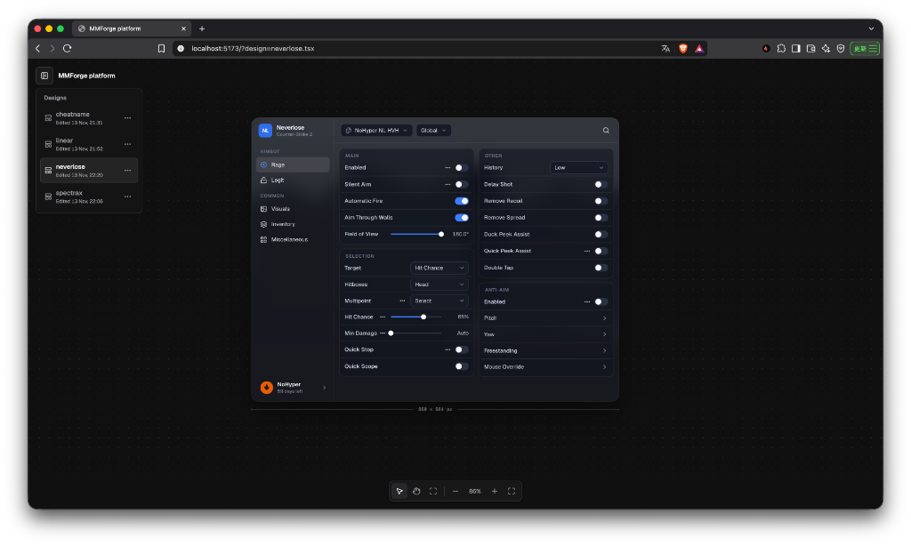
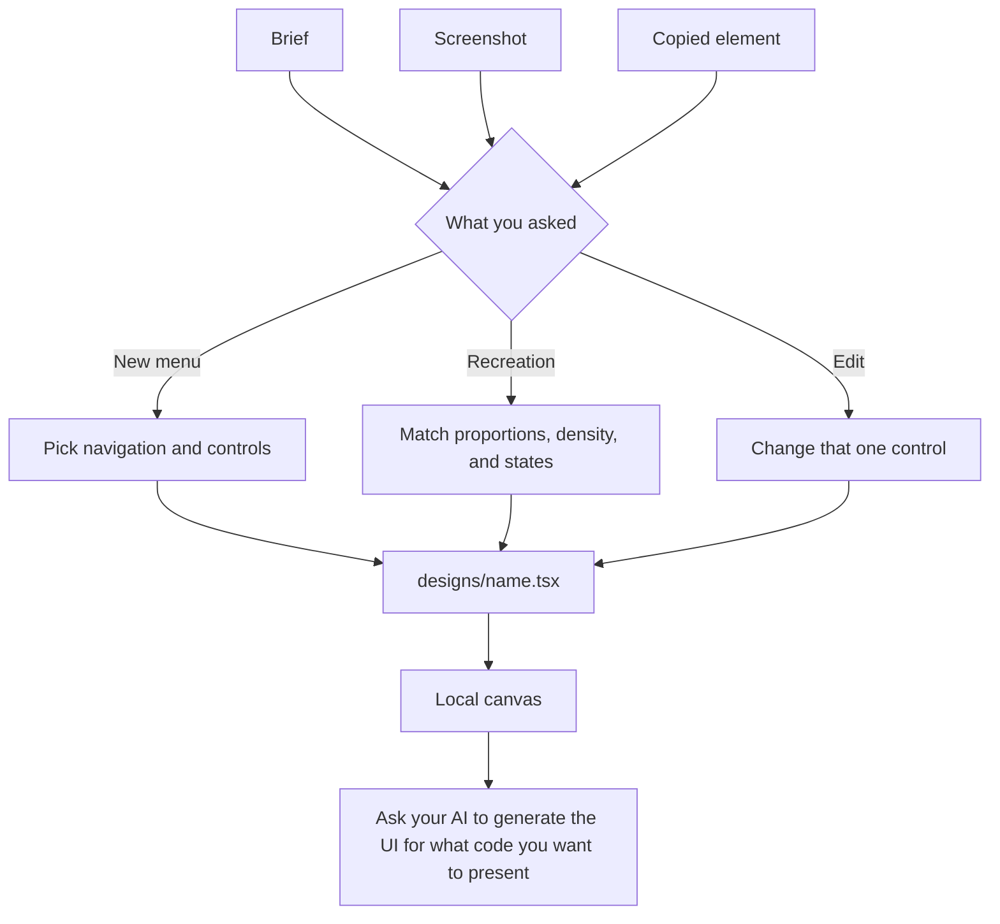

<div align="center">
  
  <h1>mmforge-platform</h1>
  <a href="https://github.com/EunChae1110/mmforge-platform">
    
  </a>
  <a href="https://github.com/EunChae1110/mmforge-platform/releases/latest">
    
  </a>
</div>




mmforge-platform is a skill for Cursor, Claude Code, and Codex that builds a mouse-operated menu you can click through in a local canvas. Give it a brief, a screenshot, or a copied element, and it chooses the navigation and controls, matches a reference when you have one, and edits a single control when you point at it. It works from the bundled Vite canvas: switches, sliders, and custom menus stay as local demo state. Nothing here attaches to a game, a process, or a remote service.

## Concept

A brief, a screenshot, or a copied element goes in. The menu lands in the local canvas. The last step is asking your AI to generate the UI for what you want to present.



## Install

```bash
npx skills add EunChae1110/mmforge-platform --skill mmforge-platform
```

Add `-g` to install it for every project on this machine. Add `-y` to skip the prompts.

The canvas needs Node.js. From the installed skill, install its dependencies and start the preview:

```bash
cd assets/canvas
npm ci
npm run dev
```

Open the URL Vite prints. The root URL is an empty canvas. A design is `http://localhost:5173/?design=example.tsx`.

## Updates

The local canvas checks [GitHub Releases](https://github.com/EunChae1110/mmforge-platform/releases) on launch. When a newer stable release is available, MMForge shows its release notes and lets you install it or keep your current version. Use the download icon beside the GitHub link to check again or revisit a skipped release.

In-app installation uses Git and npm. It preserves the `designs/` folder and asks you to restart the local canvas after installation. For a checkout of the MMForge skill repository, commit or stash local changes before installing. A standalone canvas that belongs to your own Git repository should be upgraded through that repository.

When publishing a release, set `assets/canvas/package.json` and its lockfile to the release version, then publish a GitHub release with a matching tag such as `v0.2.0` and add release notes.

## Use

Ask in your own words and the agent picks the skill up by itself.

```
Design a settings menu with a left category rail and grouped rows for display, input, and audio.
Recreate this menu from the screenshot. Match the density and the selected tab.
Change the slider row so the value sits above the track.
```

It builds or edits the menu in the canvas, then gives you the design file and the localhost preview link. Start a new agent chat after installing so the skill is picked up.

## What it does

- **New menu.** Picks a navigation structure and a settings layout for the task, then implements it as a design you can click.
- **Recreation.** Matches a reference’s proportions, density, control shapes, and selected states.
- **Edit.** Uses the copied element context, the design path, group, label, control type, and CSS selector, and changes only that control.
- **Mouse controls.** Custom dropdowns and action menus, real pointer interaction, and a check that the menu still works at its intended width.
